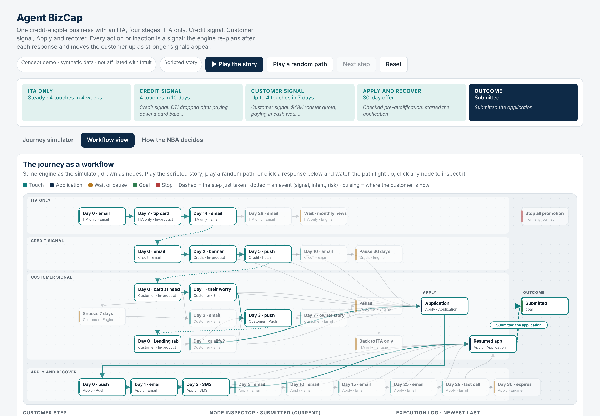

# Agentic AI Projects

Agentic AI & multi-agent system projects — LLM-orchestrated workflows built
with n8n, OpenAI, and Gemini, solving real business problems from customer
feedback analysis to AI-engine visibility analytics.

Each project folder includes the business context, how it was built (datasets,
the exact prompts, exported n8n workflows or a runnable demo), and results.

## Latest project

### [Agent BizCap](./agent-bizcap) · Nov 2026

An adaptive next-best-action agent for small-business lending lifecycle marketing that follows one credit-eligible business from an invitation to apply (ITA) to a submitted loan application. The strongest signal sets the stream (ITA only → credit signal → customer signal → apply and recover); after every response or silence the agent scores channel, timing and message against fatigue and opt-out risk, explains each decision with its score or rule, and can play a scripted story or a random path.

[Project README](./agent-bizcap) · [Demo source](./agent-bizcap/index.html) · [Email creatives](./agent-bizcap/examples/email-creatives)

## All projects (newest first)

| Added | Project | Problem | Approach |
|---|---|---|---|
| Nov 2026 | [Agent BizCap](./agent-bizcap) | Lending lifecycle marketing sends the same ITA offer on the same calendar to every eligible business, ignoring credit changes, needs in the books and self-directed intent | Signal-led NBA agent: four streams set by the strongest signal (ITA, credit, customer, apply and recover); channel × time × message scored against fatigue and opt-out risk, with hard rules, a 30-day recovery cadence, a workflow view and a random-path mode |
| Oct 2026 | [Capital Lifecycle Agent (Adaptive NBA)](./capital-lifecycle-agent) | Small-business lending lifecycle (lines of credit, term loans, business credit cards) runs on static journeys that ignore how each customer responds, wasting touches and risking opt-outs | Adaptive next-best-action engine: every action or inaction updates customer state; channel × time × message is scored against cadence, fatigue and opt-out risk, with lending compliance checks, holdout-based experiments and an n8n-style workflow view |
| Sep 2026 | [Lifecycle Delinquency Comms Engine](./lifecycle-delinquency-comms-engine) | Compliant, personalized collections communications at scale require constant re-evaluation of consent, risk, and behavior signals | Dynamic-adaptive comms architecture (8-layer design) + working n8n proof-of-concept generating FDCPA-compliant, tone-calibrated email/SMS by DPD stage |
| Sep 2026 | [Last-Mile Delivery Exception Handler](./last-mile-delivery-exception-handler) | Manual triage of delivery exceptions is slow, inconsistent, and costly at ~10% of shipment volume | Multi-agent pipeline (resolution agent + critic, communication agent + critic) grounded in a RAG policy playbook, with tier-aware messaging and its own evaluation harness |
| Sep 2026 | [Shipment Disruption Router](./shipment-disruption-router) | Manual dispatcher review of shipment disruptions causes latency, misrouting, and no audit trail | Three-agent pipeline (classify → route → audit) grounded in a logistics policy rulebook, benchmarked by a separate offline evaluation harness |
| Sep 2026 | [AI Helpdesk Copilot (Multi-Agent)](./ai-helpdesk-copilot-multiagent) | Manual support ticket triage is slow and inconsistent; responses risk hallucinating unsupported claims | Four-agent pipeline (triage → draft → critic) grounded in historical tickets via RAG, with prompt-injection detection and confidence/policy gating at every stage |
| Sep 2026 | [Reimbursement Agent (MCP Architecture)](./reimbursement-mcp-agent) | Manual expense processing is slow, inconsistent, and error-prone as claim volume grows | Multi-workflow MCP architecture: orchestrator agent calls tools (bill structuring, policy caps, utilization, email) exposed by a dedicated MCP server, with a self-auditing bill-parsing sub-workflow |
| Sep 2026 | [ClaimAudit AI — Responsible AI Agent](./claimaudit-responsible-ai-agent) | Healthcare audit teams depend on IT/data teams just to query claims data, slowing down compliance work | Chat agent generates safe SQL from plain language, with input/output guardrails, PII redaction, confidence scoring, and full audit logging |
| Sep 2026 | [GlobalEdge Market Intelligence RAG](./globaledge-market-intelligence-rag) | Brokers can't read enough overnight news/filings before client calls to give sourced, compliant recommendations | RAG system (Pinecone + OpenAI) answers plain-English broker queries with cited sources, graded by an LLM-as-a-judge |
| Sep 2026 | [ShopNest Support Automation](./shopnest-support-automation) | E-commerce support team loses time decoding tickets and drafting inconsistent responses | Multi-stage LLM pipeline generates summaries and policy-aligned responses, scored by an LLM-as-a-judge at each stage |
| Sep 2026 | [News Article Categorization](./news-article-categorization) | News aggregator needs scalable, consistent article tagging as volume grows | LLM classification chain assigns category, scored against ground truth via n8n's evaluation node |
| Sep 2026 | [Nima ABSA Sentiment Analysis](./nima-sportswear-sentiment-analysis) | Sportswear brand needs to understand *why* customers are dissatisfied from unstructured reviews | Parallel LLM nodes extract aspect, sentiment, and reason from each review |

More projects coming soon.

---
*Portfolio work — all rights reserved. Shared for demonstration purposes only.*
