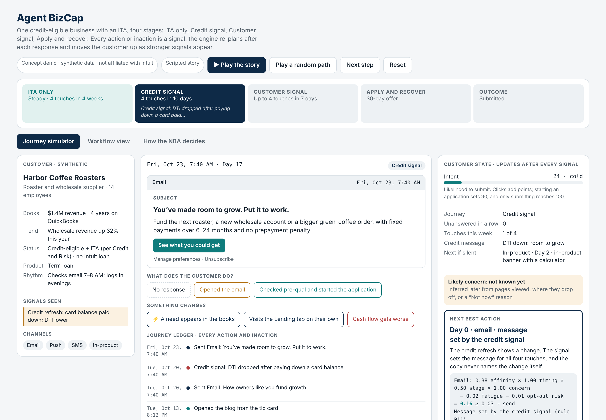
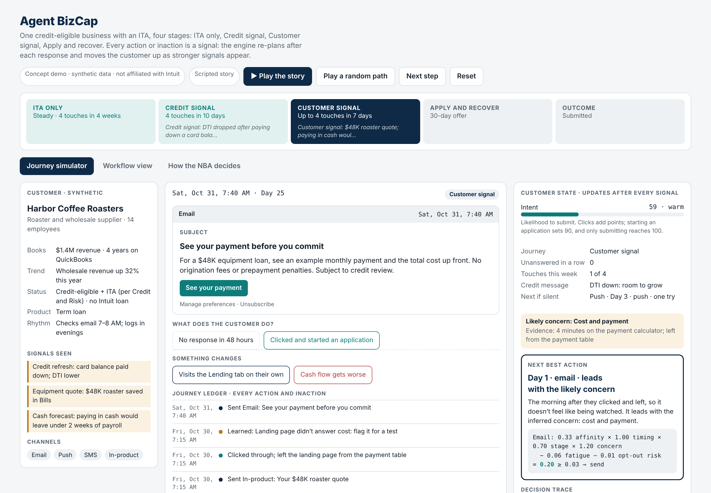
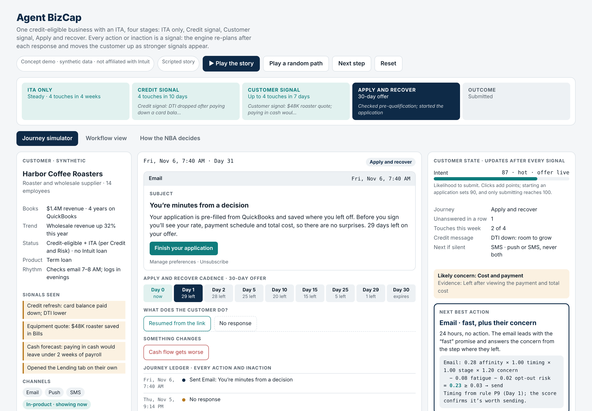
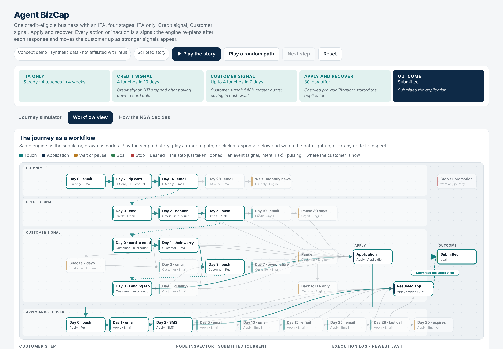
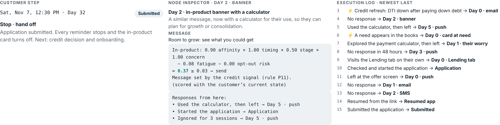
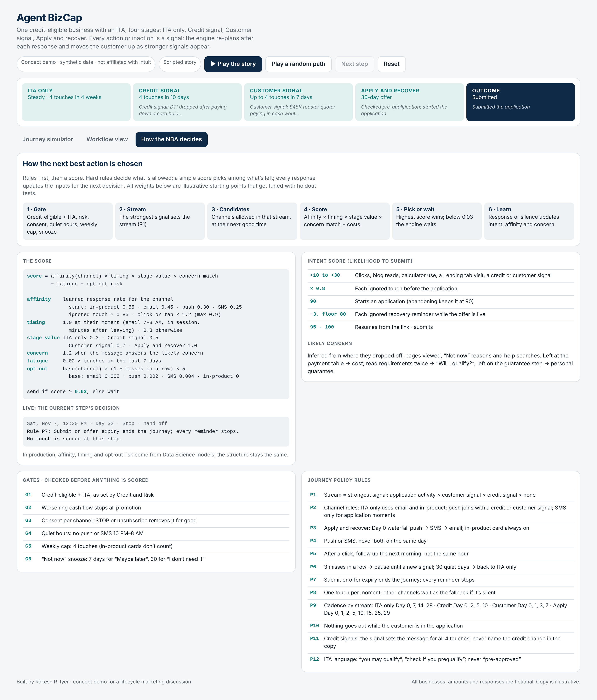
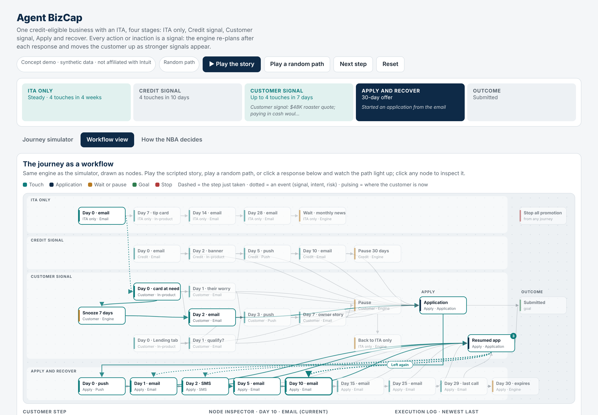
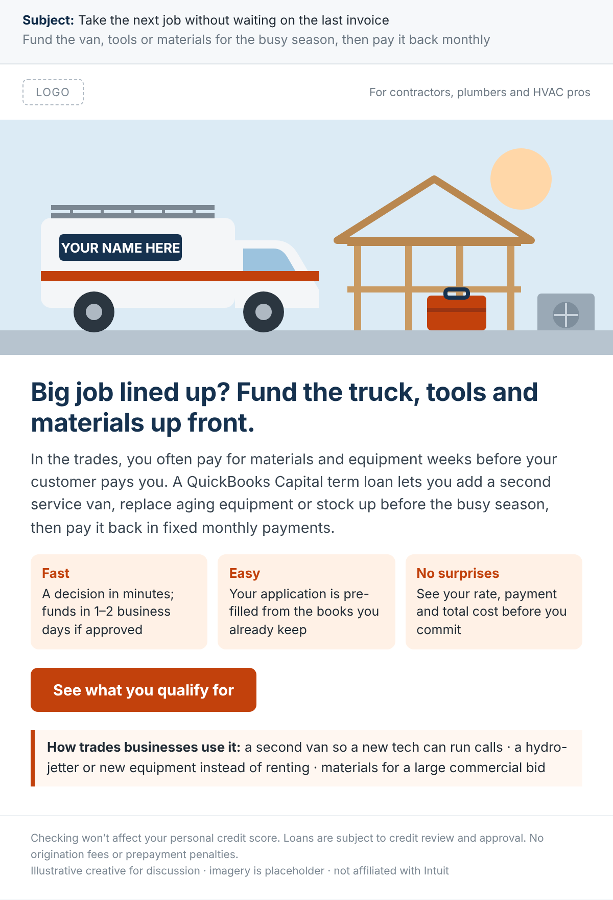
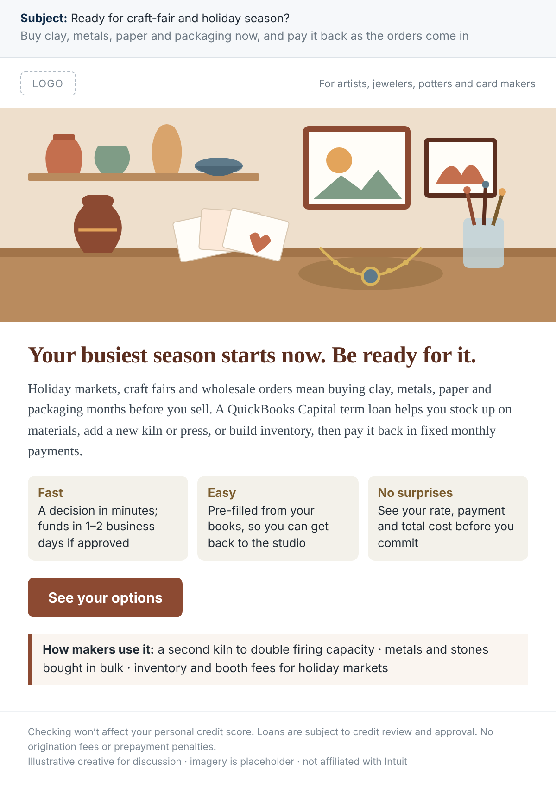
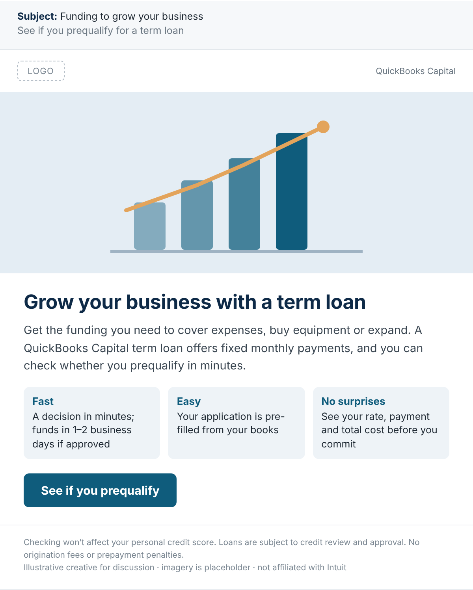

# Agent BizCap

**A [Tejentic.ai](https://tejentic.ai) prototype: an adaptive next-best-action engine for small-business lending lifecycle marketing.**

**[▶ Try it live](https://emailrakeshr870-bot.github.io/Agentic-AI-Projects/agent-bizcap/)** · no install, runs in the browser

Agent BizCap follows one credit-eligible small business from an **invitation to apply (ITA)** to a submitted loan application. Every action *or inaction* is a signal: after each response or silence, the engine updates the customer's state, picks the next best touch (or decides to wait), and moves the customer to a higher-priority stream as stronger signals appear.

> **Concept demo.** All businesses, amounts, scores and responses are synthetic. Copy is illustrative. Not affiliated with, endorsed by, or built for Intuit or QuickBooks.



---

## Why it exists

Most lending lifecycle programs are **eligibility-led and calendar-based**: everyone with an ITA gets the same offer on the same schedule. Agent BizCap shows the alternative:

| From | To |
|---|---|
| Product-centric communications | Customer-centric communications, driven by credit, need, behavior and intent signals |
| Ad hoc, single-channel campaigns | Multi-channel orchestration across email, in-product, push and SMS |
| Calendar-based blasts | Triggered, drip communications where each response sets the next touch |

At Tejentic.ai, we build agents like this to automate lifecycle marketing: they decide who to message, what to say, when and where, and they explain every decision.

---

## Quick start

It's a single HTML file with no build step and no dependencies.

```bash
git clone https://github.com/emailrakeshr870-bot/Agentic-AI-Projects.git
cd Agentic-AI-Projects/agent-bizcap
open index.html                 # macOS (or double-click it on any OS)
python3 -m http.server 8000     # or serve it, then visit http://localhost:8000
```

Then use any of these controls:

- **▶ Play the story** runs the scripted path.
- **Play a random path** lets the engine respond to randomly drawn customer behavior.
- **Next step** walks through one step at a time.
- At any point, click a customer response or fire an event (a credit refresh, a need in the books, a Lending tab visit, or cash flow getting worse) to branch the journey.

---

## Four streams, one customer

The strongest signal always wins: **application activity > customer signal > credit signal > ITA only**.

| Stream | Trigger | Cadence | What it does |
|---|---|---|---|
| **ITA only** | Credit-eligible with an ITA, no signal yet | 4 touches in 4 weeks (Day 0, 7, 14, 28) | Education: email, then an in-product tip card. Invites a pre-qualification check, never claims "pre-approved" |
| **Credit signal** | A credit refresh: FICO up, debt-to-income down, or card balances rising | 4 touches in 10 days (Day 0, 2, 5, 10) | The signal sets the message (room to grow, may qualify for more, or consolidate), but the copy never names the credit change |
| **Customer signal** | A need in the books (e.g., a $48K equipment quote) or a self-directed Lending tab visit | Up to 4 touches in 7 days (Day 0, 1, 3, 7) | Meets the customer at the moment of need, in-product first, and leads with their likely concern |
| **Apply and recover** | Starts an application, or abandons it | 30-day offer: Day 0, 1, 2, 5, 10, 15, 25, 29 | Push → SMS → email waterfall on Day 0, deep link to the saved step, in-product card always on, and urgency as the offer nears expiry |

### The scripted story

**Harbor Coffee Roasters** (synthetic) is a 14-person roaster and wholesaler with $1.4M revenue. It's credit-eligible with an ITA, and the product is a term loan.

1. **ITA only:** silent on the Day 0 email, reads the blog from the tip card.
2. **Credit signal:** a refresh shows DTI dropped after paying down a card balance, so the message is "You've made room to grow." They use the calculator, then leave.
3. **Customer signal:** a $48K roaster quote appears in Bills. The in-product card at the moment of need is followed by a next-morning email that answers the likely concern (cost).
4. **Customer signal:** they open the Lending tab on their own and start the application, which is pre-filled from their books.
5. **Apply and recover:** they abandon at the offer screen. A Day 0 push, then a Day 1 email ("You're minutes from a decision"), then a Day 2 SMS.
6. **Outcome:** they resume from the deep link and submit. Every reminder stops.




---

## Three views

**Journey simulator.** Shows the customer, the touch they're seeing and the engine's reasoning side by side: intent score, channel status, credit message, likely concern, the next best action with its score, the decision trace, and every candidate channel with the score or rule that chose, held or blocked it.

**Workflow view.** The same engine drawn as a flowchart, with one lane per stream. The path lights up as the customer moves: dashed lines mark the step just taken, dotted lines mark events, and the pulsing node is where the customer is now. Click any node to inspect its message, score and possible responses.




**How the NBA decides.** The full rule set and scoring formula, plus a live calculation for the current step.



**Random path.** The same engine, with customer behavior drawn at random, so no two runs are alike.



---

## How the next best action is decided

**Rules first, then a score.** Hard rules decide what's allowed, a simple score picks among the rest, and every response updates the inputs.

```
1 Gate → 2 Stream → 3 Candidates → 4 Score → 5 Pick or wait → 6 Learn → (repeat)
```

```
score = affinity(channel) × timing × stage value × concern match − fatigue − opt-out risk
send if score ≥ 0.03, else wait
```

| Factor | Definition (illustrative weights) |
|---|---|
| **Affinity** | Learned response rate per channel. Starts at in-product 0.55, email 0.45, push 0.30, SMS 0.25. ×0.85 after an ignored touch, ×1.2 after a click (max 0.9) |
| **Timing** | 1.0 at the customer's moment (email 7–8 AM, in session, minutes after leaving), 0.8 otherwise |
| **Stage value** | ITA only 0.3 · Credit signal 0.5 · Customer signal 0.7 · Apply and recover 1.0 |
| **Concern match** | 1.2 when the message answers the likely concern |
| **Fatigue** | 0.02 × touches in the last 7 days |
| **Opt-out risk** | Channel base rate (email 0.002, push 0.002, SMS 0.004, in-product 0) × (1 + misses in a row) × 5 |

**Hard rules**

| ID | Rule |
|---|---|
| G1 | Credit-eligible with an ITA, as set by Credit and Risk |
| G2 | Worsening cash flow stops all promotion |
| G3 | Consent per channel; STOP or unsubscribe removes it for good |
| G4 | Quiet hours: no push or SMS 10 PM–8 AM |
| G5 | Weekly cap: 4 touches (in-product cards don't count) |
| G6 | "Not now" snooze: 7 days for "Maybe later", 30 for "I don't need it" |
| P1 | Stream = strongest signal: application activity > customer signal > credit signal > none |
| P2 | Channel roles: ITA only uses email and in-product; push joins with a signal; SMS only for application moments |
| P3 | Apply and recover: Day 0 waterfall push → SMS → email; in-product card always on |
| P4 | Push or SMS, never both on the same day |
| P5 | After a click, follow up the next morning, not the same hour |
| P6 | 3 misses in a row → pause until a new signal; 30 quiet days → back to ITA only |
| P7 | Submit or offer expiry ends the journey; every reminder stops |
| P8 | One touch per moment; other channels wait as the fallback if it's silent |
| P9 | Cadence by stream (see the table above) |
| P10 | Nothing goes out while the customer is in the application |
| P11 | Credit signals set the message for all 4 touches; the copy never names the credit change |
| P12 | ITA language: "you may qualify", "check if you prequalify"; never "pre-approved" |

**Intent (likelihood to submit).** Clicks and signals add 10 to 30 points, and each ignored touch multiplies the score by 0.8. Starting an application sets it to 90; abandoning keeps it there, and each ignored recovery reminder subtracts 3, down to a floor of 80. Resuming sets it to 95, and only submitting reaches 100.

**Likely concern.** Inferred from where the customer dropped off, pages viewed, "Not now" reasons and help searches. Leaving at the payment table means cost, reading the requirements twice means "Will I qualify?", and leaving on the guarantee step means personal guarantee. The next message leads with that concern.

Every rule and weight is a **starting assumption**, meant to be tested against a randomized holdout. The primary metric is incremental funded $ per credit-eligible customer. In production, affinity, timing and opt-out risk would come from data-science models, while the decision structure stays the same.

---

## Also in this repo

| Path | What it is |
|---|---|
| [`demos/capital-funnel-agent/`](demos/capital-funnel-agent/) | The earlier version: the same engine with four journeys (unaware → need signal → intent → apply and recover), before ITA and credit signals were added. See also [Capital Lifecycle Agent](../capital-lifecycle-agent) for the multi-customer version with experiments and compliance checks |
| [`examples/email-creatives/`](examples/email-creatives/) | Industry-personalized email creative for a personalization test: trades (contractors, plumbers, HVAC), makers (art, jewelry, pottery, cards) and a generic control |

| Trades | Makers | Generic control |
|---|---|---|
|  |  |  |

---

## Project structure

```
Agentic-AI-Projects/agent-bizcap/
├── index.html                      # Agent BizCap: HTML, CSS and vanilla JS, no dependencies
├── demos/capital-funnel-agent/     # earlier version of the engine
├── examples/email-creatives/       # personalized email mockups (HTML + PNG)
├── screenshots/                    # images used in this README
├── README.md
└── LICENSE
```

**Under the hood** (in `index.html`)

- `N`: the node graph. Every touch the engine can send, with its message, candidate channels and possible responses.
- `EVENTS`: signals that can fire at any time, such as a credit refresh, a need in the books, a Lending tab visit or worsening cash flow.
- `go()`: applies a response. It updates intent, affinity, concern and channel state, logs the ledger, and moves to the next node.
- `scoreOf()` / `ruleOf()`: the NBA score and the rule tags shown in the decision trace.
- `randomStep()`: draws customer behavior for **Play a random path**.
- `renderFlow()`: draws the workflow view as inline SVG.

The pages are responsive down to phone width, with light and dark themes.

---

## About

Built by **Rakesh R. Iyer**, founder of [Tejentic.ai](https://tejentic.ai), which automates marketing processes, starting with lifecycle marketing.

## License

Copyright © 2026 Rakesh R. Iyer. All rights reserved. See [LICENSE](LICENSE).
