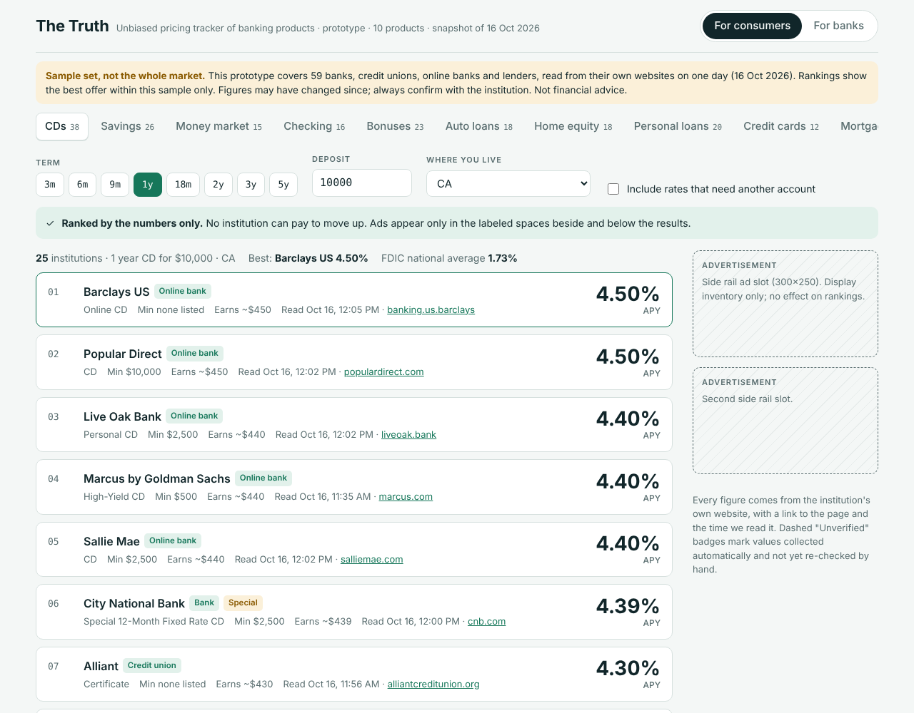
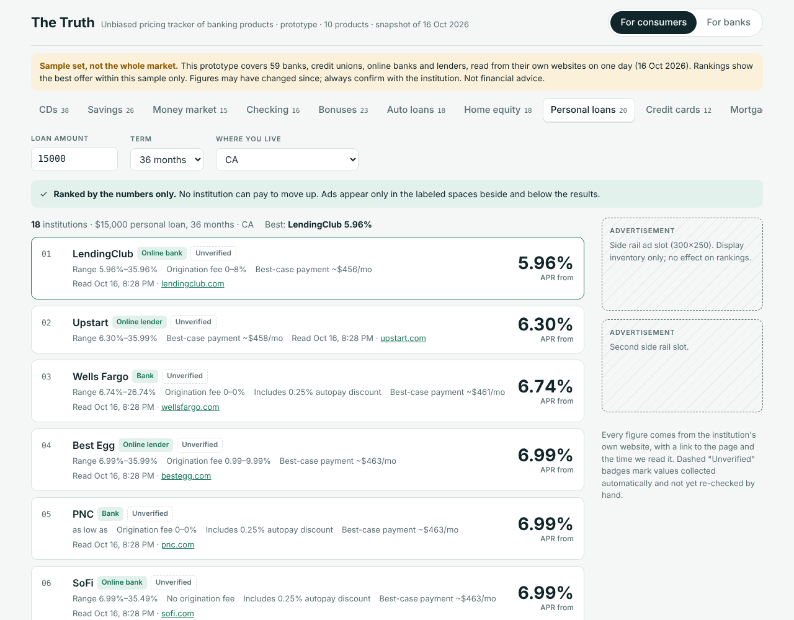
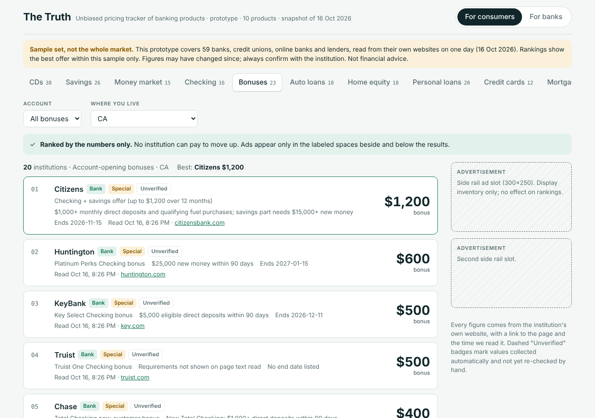
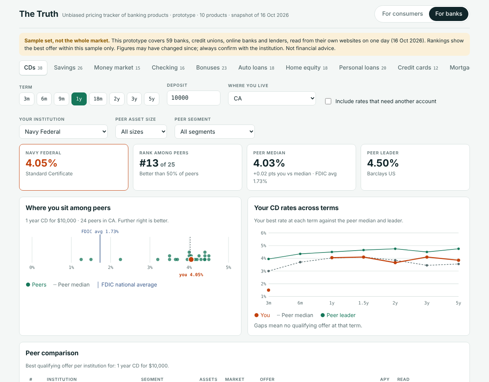
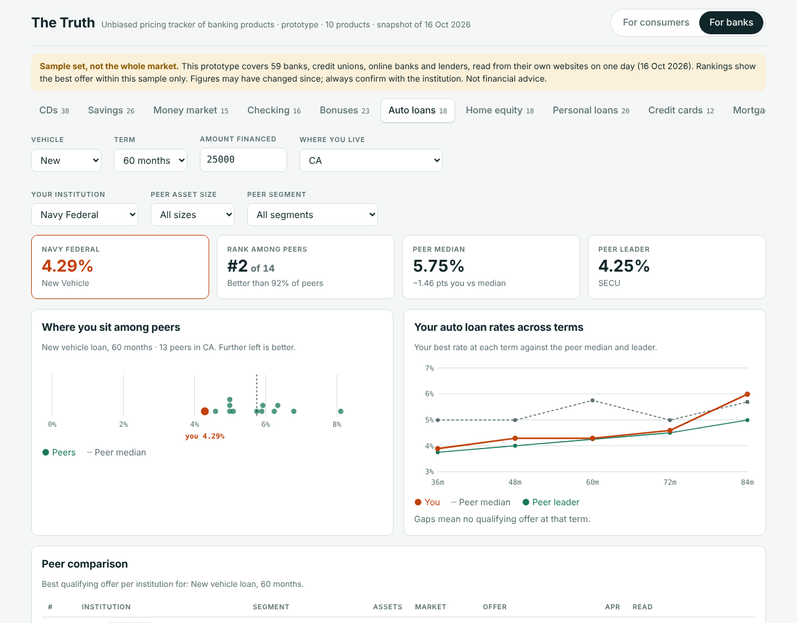

# The Truth – Unbiased Pricing Tracker of Banking Products

**What banks, credit unions and lenders actually charge and pay, read from their own websites, ranked by the numbers alone.**

The Truth is a prototype that compares ten banking products across a sample of US financial institutions. It has two views built on the same data:

- **For consumers:** a free comparison site where results are ranked only by rate, fee or bonus. No institution can pay to appear or to move up the list.
- **For banks and credit unions:** a competitive-pricing dashboard that shows where an institution's pricing sits against peers of its size, segment and market.



> ### ⚠️ This is a sample, not the whole market
> The prototype covers **59 institutions**: 11 large national banks, 9 regional banks, 6 community banks, 14 online banks and fintechs, 5 online lenders and 14 credit unions. There are roughly 4,000 FDIC-insured banks and 4,300 federally insured credit unions in the US, so this is a small, deliberately varied sample chosen to test the approach.
>
> All figures are a **one-day snapshot taken on 16 October 2026**. Rates and terms change often; many will be out of date. "Best" means best **within this sample** on that day. Nothing here is financial advice. Always confirm terms with the institution. The full list is in [docs/sample-set.md](docs/sample-set.md).

---

## Why this exists

Comparison shopping for banking products is harder than it should be. Popular comparison sites earn money when a reader clicks through or opens an account, and the institutions that pay the most often appear first. A reader can't easily tell whether "best" means best for them or best-paying for the site.

Inside banks and credit unions, the people who set prices have a different version of the same problem. Product and marketing managers often track competitors' rates by hand, checking websites and copying numbers into spreadsheets. Commercial rate data exists, but it's expensive, which puts it out of reach for many community banks and credit unions.

The Truth tests a simple idea: **collect prices once, straight from each institution's own website, and serve two audiences from the same honest data.**

## The two objectives

### 1. For consumers: an unbiased place to compare

- Rankings are determined only by the numbers: highest APY, lowest APR, lowest fee, largest bonus.
- **No paid placement.** Revenue would come from clearly labeled display ads in side and bottom rails, which never appear between results and never affect order.
- Every figure links to the institution's own page and shows when it was read.
- Filters reflect real choices: term, deposit or loan amount, where you live, and whether you're willing to open another account to get a relationship rate.
- Values collected automatically and not yet re-checked by hand are labeled **Unverified**.

### 2. For banks and credit unions: know where you stand

- Pick your institution and a peer group by **asset size**, **segment** (large national, regional, community, online, credit union) and **market**.
- See your **rank and percentile**, the **peer median**, the **peer leader**, and the **FDIC national average** where one exists.
- For CDs and auto loans, see your rates **across every term** against the peer median and leader.
- A full peer table links to every source.
- The same answers are designed to be available to analysts' AI agents through an API and MCP server. The dashboard shows the call and response a `compare_offers` tool would return. (The API itself isn't built in this prototype.)
- The data model stores every observation with a timestamp and never overwrites history, so **rate changes and trends** accumulate over time.

## How it benefits society and consumers

- **Better returns and cheaper borrowing.** In this sample, a 1-year CD ranged from about 0.05% to 4.50% APY. On $10,000 that's the difference between earning $5 and $450 a year. For loans, the spread between lenders is similar. Making those gaps visible puts real money back in household budgets.
- **Trust through transparency.** Ranking by the numbers, linking every figure to its source, and stating what isn't verified lets readers check the work instead of taking it on faith.
- **Small institutions get seen.** Credit unions and community banks often price competitively but can't outbid large advertisers for placement. A neutral ranking lets the best offer win, regardless of marketing budget.
- **Clearer fine print.** Requirements that change the real price, such as a checking account needed for a relationship rate, an autopay discount, an origination fee or a bonus's deposit threshold, are surfaced next to the headline number.
- **Healthier competition.** When prices are easy to compare, institutions compete more on price and less on marketing, which benefits all savers and borrowers, including those who never visit the site.

## How it benefits banks and credit unions

- **Faster, cheaper competitive intelligence.** Replaces manual website checks and spreadsheets with a daily, sourced view of competitors' pricing.
- **Accessible to smaller institutions.** A self-serve product priced for community banks and credit unions, not just the largest players.
- **Better pricing decisions.** Seeing your rank against peers of your size and market helps you avoid overpaying for deposits and avoid falling behind on loan pricing, protecting both margins and members.
- **Peer groups that fit.** Compare against institutions like you, by asset size, segment and geography, instead of national averages alone.
- **Ready for AI-assisted analysis.** An API and MCP server would let analysts and their agents ask questions like "where does our 12-month CD rank among credit unions in Texas?" and get sourced answers.
- **Trend history.** Because observations are never overwritten, a daily collector builds a history of competitors' changes: who moved rates, when, and by how much.

## Products covered

| Product | Institutions with data | Ranked by |
|---|---|---|
| Certificates of deposit (CDs) | 38 | APY by term and deposit amount |
| Savings accounts | 26 | APY by balance |
| Money market accounts | 15 | APY by balance tier |
| Checking accounts | 16 | Monthly fee or overdraft fee |
| Account-opening bonuses | 23 | Bonus amount, with requirements and end dates |
| Auto loans | 18 | Lowest published APR by vehicle type and term |
| Home equity (HELOC and fixed loans) | 18 | Ongoing APR, with intro offers |
| Personal loans | 20 | Lowest published APR for the amount and term |
| Credit cards | 12 issuers, 18 cards | Lowest purchase APR or longest 0% intro period |
| Mortgages | 9 | APR of published sample rates, with their assumptions |

Loans, cards and mortgages are compared on **published terms only** (APR floors and ranges, fees, sample rates with their stated assumptions). The prototype never submits personal information or prequalification forms, so it can't show the rate a specific borrower would be offered.

## Screenshots

| | |
|---|---|
|  |  |
| **Consumers:** personal loans | **Consumers:** account-opening bonuses |
|  |  |
| **Banks:** CD position vs peers | **Banks:** auto loan rates across terms |

## Try it

Open `dashboard/index.html` in any modern browser. It's a single self-contained file with all data embedded; no server or install needed. Use the **For consumers / For banks** switch at the top and the product tabs to move between views.

## What's in this repository

```
dashboard/
  index.html                 The dashboard (all 10 product tabs, both views)
  src/template.html          Page source; data is injected at build time
data/
  schema.sql                 Database schema (observation tables are append-only)
  institutions.csv           The 59-institution sample, with FDIC/NCUA asset data
  dashboard_data.json        Latest values exported for the dashboard
  coverage_gaps.json         Institutions that couldn't be tracked for a product, and why
  snapshots/2026-10-16/      One CSV per product
pipeline/
  load_cd_observations.py    Append CD captures to the database (raw captures not included here)
  load_offer_observations.py Append captures for the other nine products
  export_dashboard_data.py   Export latest values (rejected observations excluded)
  build_dashboard.py         Build dashboard/index.html from the template and data
  export_csv_snapshots.py    Write the per-product CSVs
  create_empty_db.py         Start a fresh database seeded with the sample institutions
docs/
  methodology.md             How data was collected and checked, and known limits
  data-dictionary.md         Tables and fields
  sample-set.md              Every institution and which products have data
  spot-checks.md             Verification results
```

To rebuild the dashboard after changing data (Python 3.9+, standard library only):

```bash
python3 pipeline/export_dashboard_data.py
python3 pipeline/build_dashboard.py
```

## How the data was collected

In short: rate pages were located on each institution's own website, read in a real browser where pages load rates with JavaScript, and stored with the source link and capture time. Some values were extracted with an automated research agent and are marked unverified until checked. About 70 values were re-checked against live pages; errors found were corrected with new observations rather than edits, so the history stays intact. Full details, including known limitations, are in [docs/methodology.md](docs/methodology.md) and [docs/spot-checks.md](docs/spot-checks.md).

Asset sizes come from FDIC and NCUA call reports (Q2 2026). National average rates come from the FDIC's [National Rates and Rate Caps](https://www.fdic.gov/national-rates-and-rate-caps) (21 September 2026).

## Status and roadmap

This is a **prototype built on a one-day snapshot**. It doesn't update itself. Next steps toward a working product:

1. A daily headless-browser collector, so rate history and change alerts build up.
2. Region mapping for banks that price by market, so geography filters reflect what each area is actually offered.
3. Broader coverage beyond this sample.
4. The API and MCP server for banks' analysts and agents.
5. A review of advertising-disclosure obligations and each site's terms of use before any public launch.

## Disclaimer

The Truth is an independent prototype. It is not affiliated with, endorsed by, or paid by any institution named. Institution and product names are trademarks of their respective owners and are used only to identify the products compared. Figures were read from public web pages on 16 October 2026 and may be incomplete, out of date or wrong; values marked Unverified have not been re-checked by hand. This is not financial, legal or tax advice. Confirm all terms with the institution before making any decision.

## Copyright

Copyright © 2026 Rakesh R. All rights reserved. See [LICENSE](LICENSE). No permission is granted to copy, modify, distribute or use this work without prior written permission.
